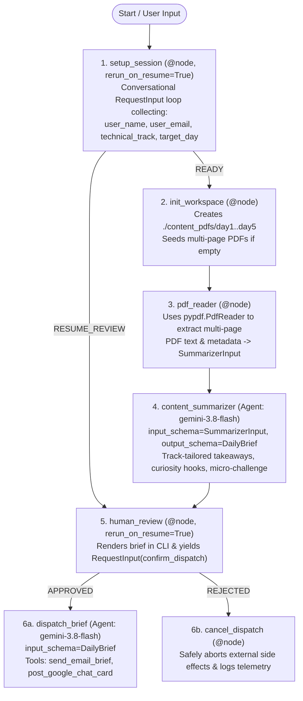

# AI in 5 Days — Content Customizer Agent (`ai-in-5-days-agent`)

An enterprise **ADK 2.0 Graph `Workflow` Agent** (`google.adk.workflow.Workflow`) built with `agents-cli` (`v1.9.0`) and powered by **`gemini-3.8-flash`**. The agent scaffolds a local/containerized multi-day training PDF workspace (`./content_pdfs/day1`–`day5`), extracts multi-page courseware via `pypdf` into strict Pydantic data contracts, synthesizes track-personalized daily briefs (**Engineer** or **Architect**) with curiosity hooks and hands-on micro-challenges, enforces a **Human-in-the-Loop (`RequestInput`) approval gate**, and coordinates multi-channel dispatch to **Email** and **Google Chat Card v2** webhooks.

---

## Architecture & ADK 2.0 `Workflow` Graph



---

## Automated Rubric Alignment (Agent Assessor — 5 Pillars)

| Rubric Pillar | Implementation Highlights | Key Files |
| :--- | :--- | :--- |
| **1. Tool & Interface Design** | Deterministic node separation (`init_workspace`, `pdf_reader`) + LLM tool execution (`send_email_brief`, `post_google_chat_card`) with Google-style docstrings, type annotations, and strict Pydantic v2 contracts (`LearnerProfile`, `WorkspaceStatus`, `ExtractedPdfContent`, `SummarizerInput`, `DailyBrief`, `DispatchReceipt`). | `app/tools.py`, `app/agent.py` |
| **2. Context & Memory** | Typed `WorkflowState(BaseModel)` schema registered via `Workflow(..., state_schema=WorkflowState)`. Persists `user_name`, `user_email`, `technical_track`, `target_day`, `extracted_pdf`, `daily_brief`, `review_decision`, and `dispatch_receipt` across `RequestInput` pause/resume turns and `VertexAiSessionService`. | `app/tools.py`, `app/agent.py`, `app/app_utils/services.py` |
| **3. Orchestration & Logic** | Declarative ADK 2.0 `Workflow` (`root_agent`) with `Edge` and conditional routing (`{"READY": "init_workspace", "RESUME_REVIEW": "human_review"}` and `{"APPROVED": "dispatch_brief", "REJECTED": "cancel_dispatch"}`). Two `@node(rerun_on_resume=True)` Human-in-the-Loop checkpoints (`setup_session` and `human_review`). | `app/agent.py` |
| **4. Observability & Tracing** | Structured JSON Cloud Logging via `emit_telemetry_log()` across every node transition (`node_start`, `node_complete`, `node_error`, `interrupt_pause`) + `before_agent_callback`, `after_agent_callback`, `before_model_callback`, `after_model_callback`, `before_tool_callback`, `after_tool_callback`, and OpenTelemetry Cloud Trace / BigQuery completions export. | `app/agent.py`, `app/tools.py`, `app/app_utils/telemetry.py`, `deployment/terraform/*/telemetry.tf` |
| **5. Infrastructure & CI/CD** | Production containerization (`Dockerfile`), locked dependencies (`pyproject.toml`, `uv.lock`), single-project & multi-stage CI/CD Terraform IaC (`deployment/terraform/single-project/` and `deployment/terraform/cicd/`), GitHub Actions pipelines (`.github/workflows/pr_checks.yaml`, `staging.yaml`, `deploy-to-prod.yaml`), unit tests (`tests/unit/`), LLM-as-a-Judge evaluation suite (`tests/eval/`), and Locust load tests (`tests/load_test/`). | `Dockerfile`, `.github/workflows/`, `deployment/terraform/`, `tests/` |

---

## Project Structure

```text
ai-in-5-days-agent/
├── app/
│   ├── agent.py                   # ADK 2.0 Workflow graph (6 nodes, HITL RequestInput, callbacks)
│   ├── tools.py                   # Pydantic v2 schemas, pypdf extraction, Email & Google Chat Card v2 tools
│   ├── training_corpus.json.gz    # Compressed 251-page training corpus for container workspace seeding
│   ├── fast_api_app.py            # Unified FastAPI server (ADK, A2A protocol, Reasoning Engine routes)
│   └── app_utils/                 # Telemetry, VertexAiSessionService, and A2A helpers
├── content_pdfs/                  # Structured local directory (day1 through day5 training PDFs)
├── dispatched_briefs/             # Local outbox archive (.md, .eml, and Google Chat Card v2 .json)
├── .github/workflows/             # GitHub Actions CI/CD (pr_checks.yaml, staging.yaml, deploy-to-prod.yaml)
├── deployment/terraform/          # Terraform IaC (single-project/ and cicd/)
├── tests/
│   ├── unit/test_dummy.py         # Pytest unit tests for all workflow nodes, schemas, and HITL routing
│   ├── eval/                      # Golden evaluation dataset (basic-dataset.json) & eval_config.json
│   └── load_test/load_test.py     # Locust load testing suite
├── Dockerfile                     # Production container definition for Agent Runtime / Cloud Run
├── deployment_metadata.json       # Deployed Vertex AI Agent Runtime metadata
├── GEMINI.md                      # AI-assisted development guide
└── pyproject.toml                 # Locked dependencies & tool configuration
```

---

## Quick Start

Install `agents-cli` and dependencies:

```bash
uvx google-agents-cli setup
agents-cli install
```

### Run Locally (CLI or Web Playground)

```bash
# One-shot or multi-turn CLI run
agents-cli run "Name: Rafee Mohamed, Email: kmrafee@google.com, Track: Architect, Day: day1"

# Launch interactive browser UI
agents-cli playground
```

### Run Unit Tests & Evaluation Suite

```bash
# Run deterministic unit tests
uv run --no-sync pytest tests/unit

# Run ADK / Vertex AI GenAI Evaluation suite
agents-cli eval run
```

### Deploy & Query on Vertex AI Agent Runtime

```bash
# Validate deployment configuration
agents-cli deploy --dry-run --no-confirm-project

# Deploy to Vertex AI Agent Runtime
agents-cli deploy --project kmrafee-aistraining --region us-east1 --no-confirm-project

# Query deployed Agent Runtime endpoint
agents-cli run --url "https://us-east1-aiplatform.googleapis.com/v1/projects/873819376710/locations/us-east1/reasoningEngines/3550047068670132224" --mode adk "Name: Rafee Mohamed, Email: kmrafee@google.com, Track: Architect, Day: day1"
```
